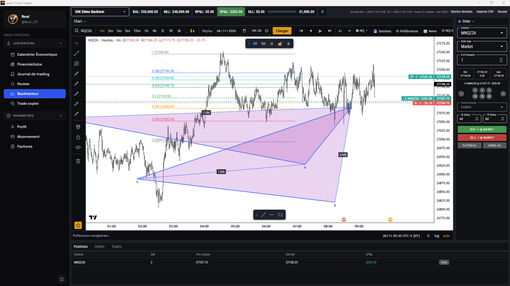

# Inner Circle Trader

Application de trading personnelle pour les futures **NQ / ES** (prop firm TopstepX) : calendrier économique USD en heure de New York, journal de trading, review Notion, **backtesteur façon TopstepX / FXReplay** et trade copier Tradovate — en site web et en application Windows.



## Fonctionnalités

- **Calendrier économique USD** — news à impact fort / moyen / faible, résultats d'entreprises, jours fériés NYSE, tout en heure de New York (ET).
- **Backtesteur** — replay minute par minute de NQ / ES (données TopstepX depuis juillet 2023), compte démo 50K avec règles MLL / DLL, ordres marché / limite / stop, TP/SL glissables avec P&L affiché.
  - ~85 outils de dessin (Fibonacci, Gann, figures harmoniques, Elliott, positions long/short, profils de volume…), favoris et barre de favoris, raccourcis FXReplay.
  - Arborescence des objets (groupes, renommer, glisser-déposer, multi-sélection, clic droit).
  - Préférences du chart, **sessions de backtest enregistrées**, **mises en page** avec dessins propres et sauvegarde automatique.
  - News Forex Factory sous les bougies, 2 charts côte à côte (NQ + ES).
  - Une unité de temps = son propre CSV (`NQ_m15.csv`, `NQ_H1.csv`…).
- **Journal de trading** — statistiques TopstepX par compte, calendrier P&L, graphiques, images et tags.
- **Review Notion** — lecture et écriture dans tes bases Notion (journal, homework).
- **Trade copier Tradovate** — copie leader → followers (mode simulation par défaut).
- **Sauvegardes automatiques** quotidiennes de toutes les données (14 jours gardés).

## Technologies

- HTML / CSS / JavaScript sans framework ni bundler (un seul `index.html`)
- [Lightweight Charts](https://github.com/tradingview/lightweight-charts) (TradingView) et [d3](https://d3js.org)
- [Electron](https://www.electronjs.org) + electron-builder pour l'application Windows
- Node.js 22 (tests avec `node --test`), Python pour les scripts de données
- GitHub Actions (build de l'exe et release) + GitHub Pages (site)

## Installation et lancement

**Utiliser l'app :** télécharger `Inner.Circle.Trader.exe` dans les [Releases](https://github.com/Neal40/economic-calendar/releases/latest), le renommer `Inner Circle Trader.exe` et le lancer (portable, pas d'installation). La version web est sur [GitHub Pages](https://neal40.github.io/economic-calendar/).

**Développer :**

```bash
git clone https://github.com/Neal40/economic-calendar.git
cd economic-calendar/desktop
npm ci
npm run ict              # build rapide de l'exe, copié sur le Bureau (Inner Circle Trader)
npm run dist             # build compressé, comme la release
node --test              # tests (copier, données de marché, sauvegardes)
node ../tools/check.js   # vérification syntaxe + contrat IPC
```

La version web s'ouvre directement : `index.html` dans un navigateur (aucune installation).

## Origine des données

| Donnée | Source | Clé nécessaire |
|---|---|---|
| Calendrier économique | Forex Factory (événements embarqués) + dates officielles Fed / BLS / BEA / Census (`scripts/generate_2027.py`) | non |
| Prévision / précédent de la semaine | Flux officiel Forex Factory (`nfs.faireconomy.media`) | non |
| Bougies m1 / 1 s | TopstepX, avec ta propre session (connexion dans l'app) | non (session TopstepX) |
| Journal de trading | TopstepX (ta session) | non |
| Review | API Notion officielle | **oui** : token d'intégration Notion, saisi dans l'app, chiffré (`safeStorage`) |
| Trade copier | API Tradovate | identifiants Tradovate saisis dans l'app, chiffrés |

Aucune donnée de compte n'est stockée dans ce dépôt.

## Versions

Le projet suit le [versionnage sémantique](https://semver.org/lang/fr/) (`MAJEUR.MINEUR.CORRECTIF`). La version est celle de `desktop/package.json`, chaque version publiée est marquée par un tag `vX.Y.Z`, et l'historique est dans le [CHANGELOG](CHANGELOG.md). Chaque push sur `main` reconstruit l'exe et met à jour la release `latest`.
