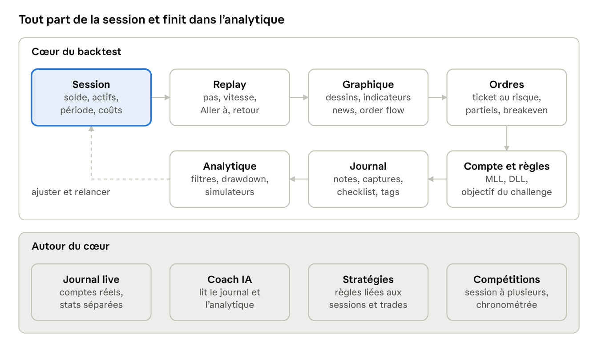
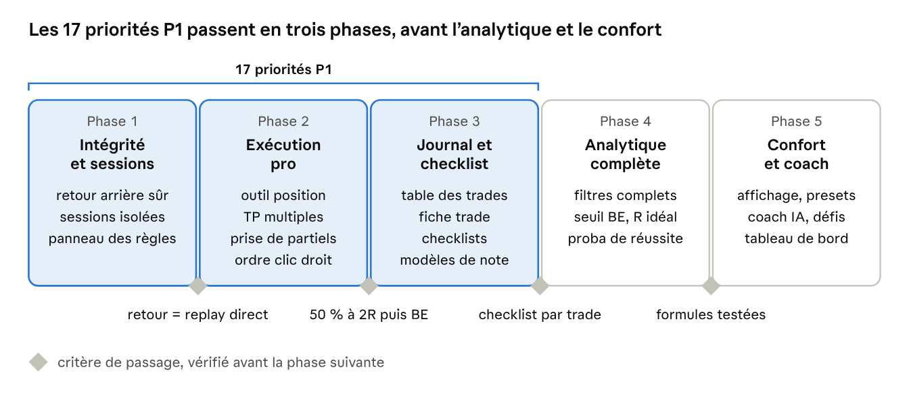

# REA salle blanche — FX Replay → App ICT

19/11/2026 · Rudy — version figée du document REA (artefact claude.ai : https://claude.ai/artifact/HTDWPBJujKNdNUn5QEDBUJ). Pour le code, c'est **ce fichier** qui fait référence : après livraison d'une exigence, passer son statut à ✅ ici.

## Résumé

Ce REA décrit en 126 exigences tout ce que fait FX Replay d'après sa documentation publique et les demandes de Rudy, et les compare à l'app ICT : 59 sont déjà là (dont 10 livrées par la phase 1 en v1.66.0 et 14 par la livraison A de la phase 1b en v1.67.0), 45 en partie, 16 manquent et 6 sont hors périmètre.

Les 25 priorités P1 portent sur six chantiers : l'arborescence des pages du Backtesteur (module NAV, demandée par Rudy le 19/11), un retour arrière qui annule vraiment ce qui suit, des sessions isolées et sauvegardées en continu, les partiels et l'ordre au clic droit, le panneau des règles du challenge, et un journal de backtest avec fiche trade et checklist. 14 sont déjà là (la phase 1 en v1.66.0, la livraison A de la phase 1b en v1.67.0 et l'absence de limites d'offre) ; la livraison B de la phase 1b termine l'arborescence (fiche stratégie, Paramètres › Journal et › Modèles), avant la phase 2.

Après les 5 phases de la roadmap, le Backtesteur aura l'équivalent fonctionnel de FX Replay pour le backtest NQ / ES, adapté aux règles ICT et prop firm de Rudy, sans rien copier de son expression. Base de travail : 84 articles d'aide sur 87, 7 pages produit, le code de la v1.65.1 et la spécification du 12/11 déjà dans le repo, que ce document remplace.

## Méthode salle blanche

Le REA sépare deux salles : la salle d'analyse lit les sources publiques de FX Replay et décrit ce que le produit fait ; la salle d'implémentation code le Backtesteur à partir de ce document seul, sans jamais ouvrir FX Replay.

| Rôle | Qui | Voit |
| --- | --- | --- |
| Salle d'analyse | Claude (cette session) | Documentation publique FX Replay, ce document |
| Salle d'implémentation | Une session Claude neuve, Woods, ou Rudy en mode dev | Ce document et le code de l'app ICT, jamais FX Replay |
| Arbitre | Rudy (a un compte FX Replay) | Les deux ; tranche les écarts, mais répond aux questions des devs en écrivant dans ce document |

Règles appliquées dans tout le document :

- **Sources autorisées** : centre d'aide public, pages produit et tarifs, blog et changelog publics. Pas de décompilation, pas de code ni d'API privée, pas de contournement d'accès payant.
- **On décrit des comportements, pas des expressions** : entrées, sorties, règles, limites. Aucun texte, capture, icône, nom de fonctionnalité déposé ni design distinctif de FX Replay n'est repris ; tout est reformulé.
- **Savoir public** : les formules de trading standard (win rate, profit factor, drawdown, expectancy…) sont définies par nous, avec nos propres conventions.
- **Traçabilité** : chaque exigence porte un identifiant (ex. REP-03) et renvoie à la page lue dans la section Sources.
- **Choix propres à l'app ICT** : stack, style TopstepX, données m1 TopstepX en CSV, comptes prop firm de Rudy. Là où FX Replay et l'app ICT diffèrent, c'est l'app ICT qui décide. Tout ce qui est repris s'ajoute au Backtesteur existant : rien n'est retiré ni remplacé, et les comportements par défaut comme les données déjà enregistrées restent inchangés.
- **Questions des devs** : elles passent par un commentaire sur ce document ; la réponse est écrite ici, jamais transmise oralement depuis FX Replay.
- **Captures de l'arbitre (19/11/2026)** : Rudy a montré l'organisation des pages de son compte FX Replay. La salle d'analyse les a lues et reformulées dans le module NAV ; elles ne sont ni dans le repo ni montrées aux implémenteurs.

Ce document décrit une méthode de travail ; ce n'est pas un avis juridique.

## Carte de la documentation étudiée

84 des 87 articles uniques du centre d'aide FX Replay ont été lus, plus 7 pages produit et notes de version ; les 3 articles non lus portent sur la connexion au compte et n'ont aucun effet sur le produit.

| Catégorie du centre d'aide | Articles | Lus | Ce qu'on en tire |
| --- | --- | --- | --- |
| Guides produit | 30 | 30 | Replay, graphique, ordres, analytique, prop firm, order flow, raccourcis |
| Prise en main | 9 | 9 | Tableau de bord, création de session, saisie d'ordres, checklist |
| Journal | 9 | 9 | Journal backtest et live, comptes, fusion de trades, analyse par tag |
| Battles | 9 | 9 | Compétitions multijoueurs (hors périmètre, adaptation solo proposée) |
| Facturation | 10 | 10 | Limites par offre, qui servent à délimiter le périmètre |
| Gestion du compte | 9 | 7 | Réinitialisation, suppression, appareils (4 articles communs avec Facturation) |
| Support | 4 | 4 | Validation des ordres, prix réels non ajustés, sauvegarde |
| Communauté | 4 | 4 | Contenu éducatif, aucune fonction |
| Hors catégorie (plan du site) | 7 | 6 | Sessions d'analytique, réinitialisation, différences de prix |

Autres sources lues :

- **Pages produit** : Backtest, Mentor IA, Tarifs.
- **Notes de version** : mars, avril et juillet 2026, plus la liste des actualités produit (Battles classées, journal live, partage public des analytics).
- **Observation antérieure déjà dans le repo** : `docs/salle-blanche-fxreplay/SPEC-backtesteur.md` (12/11/2026) et `docs/backtesteur-fxreplay.md` (07/11/2026). Ce REA les étend et les remplace.

Limites : 6 articles se résument à une vidéo (stratégie, multipaire, plusieurs charts, bougies lissées, tags, Monte Carlo) ; seul leur texte a été lu. Les notes de version détaillées (pages Notion) n'ont pas été ouvertes, seulement leurs résumés.

## Vue d'ensemble fonctionnelle

FX Replay est une plateforme web de replay manuel : on crée une session, on rejoue le marché bougie par bougie, on passe des ordres simulés, puis on étudie ses trades dans un journal et une analytique. Quatre modules gravitent autour : journal live, coach IA, stratégies et compétitions.



Le cœur est une boucle : la session lance le replay, les ordres passent par les règles du compte, puis le journal et l'analytique disent quoi ajuster pour la session suivante.

Parcours type d'un utilisateur :

1. Créer une session, backtest libre ou challenge prop firm : solde, actifs, période, coûts.
2. Rejouer : lecture, pas, sauts « Aller à », retour arrière (sauf en challenge).
3. Lire le graphique : unités de temps, mises en page, dessins, indicateurs, news, order flow.
4. Trader : ticket au risque, outil position, clic droit, presets ; gérer SL, TP, partiels et breakeven.
5. Journaliser : notes, captures, checklist, tags.
6. Mesurer : analytique filtrée, drawdown, simulateurs, calendrier, coach IA.

Les offres montrent ce que FX Replay considère comme avancé :

| Fonction | Gratuit | Intermédiaire | Pro |
| --- | --- | --- | --- |
| Prix mensuel | 0 $ | 17,99 $ | 35 $ |
| Sessions | 2 | 10 | Illimité |
| Durée d'une session | 1 mois | Illimitée | Illimitée |
| Trades par session | 50 | 200 | Illimité |
| Historique de trades conservé | 1 semaine | 6 mois | Toujours |
| Indicateurs sur le chart | 1 | 3 | Illimité |
| Mise en page multi-charts | Non | 2 charts | Illimité |
| Actifs par session | 6 | 6 | 6 |
| Sauts « Aller à » | 3 par heure | Illimité | Illimité |
| Calendrier économique | 1 pays, passé seulement | 2 pays | Illimité |
| Secondes, futures CME, unités personnalisées | Non | Non | Oui |
| Captures / checklists / stratégies dans le journal | 1 / 1 / 0 | 2 / 3 / 3 | Illimité |

Dans l'app ICT, aucune limite n'est reprise : tout est au niveau « Pro », et seules les données disponibles (NQ, ES, MNQ, MES) fixent le plafond.

## Inventaire fonctionnel par module

L'inventaire compte 126 exigences réparties en 15 modules ; chacune décrit ce que l'utilisateur peut faire, avec son statut dans l'app ICT et une priorité.

Légende — **Statut app ICT** : ✅ présent · 🟡 partiel · ❌ absent · ⛔ hors périmètre. **Priorité** : P1 gros gain pour le backtest ICT sur NQ / ES · P2 utile · P3 confort. Statuts établis en lisant le code de la v1.65.1 (`index.html`) et le CHANGELOG ; à confirmer en usage.

### 1. Sessions de backtest (SES)

Une session est un backtest nommé et isolé, avec son solde, ses actifs, sa période et ses coûts.

| ID | Exigence | App ICT | Prio |
| --- | --- | --- | --- |
| SES-01 | Créer une session par un assistant : nom, type (backtest libre ou challenge), solde de départ (préréglages 10K / 50K / 100K / 250K ou libre), stratégie liée ou à créer, un ou plusieurs actifs, mise en page optionnelle | ✅ v1.66 : assistant « Nouvelle session » (nom, libre ou challenge + mode strict, solde 10K / 50K / 100K / 250K / libre, challenge 50K / 100K / 150K aux règles Prop, stratégie, actifs) ; la mise en page reste celle du chart | P1 |
| SES-02 | Choisir la période : date de départ fixée ou tirée au hasard ; fin automatique (la session s'étend en rejouant) ou date de fin avec raccourcis +1 jour / +1 semaine / +1 mois ; bornes de données min / max affichées par actif | ✅ v1.66 : départ choisi ou tiré au hasard, fin auto ou datée (arrêt à 17:00 NY avec message), bornes par actif (app desktop) | P1 |
| SES-03 | Isoler chaque session : position du replay, compte, ordres, position, trades, notes et dessins propres (dessins partagés en option) | ✅ v1.66 : compte, ordres, trades, notes, dessins et heure du replay propres à chaque session ; dessins partagés via la synchro globale | P1 |
| SES-04 | Activer commissions et spreads par actif ; désactivés, l'exécution se fait au prix brut | ✅ v1.67 : commission et spread par actif repris de Paramètres › Spreads & commissions, activables à la création (désactivés = prix brut) ; le Backtesteur de base garde ses frais | P2 |
| SES-05 | Régler le slippage sur 4 niveaux : aucun, léger, moyen, fixe | ✅ v1.67 : aucun / léger (1 tick) / moyen (2) / fixe (N ticks), par session, valeur par défaut dans Paramètres | P2 |
| SES-06 | Choisir netting (un ordre opposé réduit ou ferme) ou hedging, fixé à la création ; netting par défaut sur futures | ✅ netting, une position à la fois (le hedging est inutile sur futures) | — |
| SES-07 | Appliquer la marge réelle de l'actif plutôt qu'un ratio de session | ⛔ sans objet pour des comptes prop futures | — |
| SES-08 | Lisser l'affichage des bougies journalières (supprimer les trous), sans effet sur les trades | ❌ | P3 |
| SES-09 | Enregistrer une configuration de session en preset et la réappliquer | ✅ v1.67 : presets en tête de la fenêtre « Nouvelle session » (tous les réglages sauf le nom et la date de départ) | P2 |
| SES-10 | Liste des sessions : recherche, filtre, tri, reprise en un clic, renommer, dupliquer, supprimer, ouvrir l'analytique | ✅ v1.67 : Testing › Sessions (recherche, type, stratégie, tri, reprendre, renommer, dupliquer, analytique, supprimer vers la corbeille ; instantanés à part) | P2 |
| SES-11 | Corbeille : restaurer une session supprimée, ou la supprimer définitivement | ✅ v1.67 : Paramètres › Sessions supprimées (compte, trades, dessins et heure du replay gardés jusqu'à la suppression définitive) | P3 |
| SES-12 | Sauvegarder la session en continu, sans action de l'utilisateur | ✅ v1.66 : session enregistrée toutes les 5 s, à chaque ordre, à la fermeture et au changement de session ; rouverte au lancement | P1 |

Sources : [Créer sa première session](https://support.fxreplay.com/articles/setting-up-your-first-backtesting-session), [Tableau de bord](https://support.fxreplay.com/articles/exploring-the-trader-dashboard-overview), [Spreads et commissions](https://support.fxreplay.com/articles/understanding-spreads-and-commissions), [Offres](https://support.fxreplay.com/articles/what-are-the-differences-between-fx-replay-plans-and-their-pricing), [Bougies lissées](https://support.fxreplay.com/articles/what-is-the-smoothing-candle-feature).

### 2. Moteur de replay (REP)

Le replay fait avancer le marché sans jamais montrer le futur, et le retour arrière doit remettre tout l'état à ce point.

| ID | Exigence | App ICT | Prio |
| --- | --- | --- | --- |
| REP-01 | Barre de replay : lecture / pause, pas suivant, pas précédent, vitesse au curseur, raccourcis | ✅ vitesse temps réel → 300× | — |
| REP-02 | Pas du replay indépendant de l'unité du chart, avec « synchroniser avec le chart » activé par défaut | ✅ v1.51 | — |
| REP-03 | Tous les charts avancent ensemble sur la même horloge | ✅ | — |
| REP-04 | Revenir à une bougie choisie (clic, ou clic droit « rejouer depuis ici »), après un avertissement | ✅ v1.66 : clic droit « Rejouer depuis ici » ou bouton de la barre de replay puis clic, avertissement listant trades et ordres annulés | P1 |
| REP-05 | Le retour arrière annule tout ce qui suit ce point : trades, ordres, solde, règles ; impossible avant la date de départ ; si des trades ou ordres suivent, « bougie précédente » propose d'annuler ce qui suit ou de reculer seulement l'affichage, comme aujourd'hui | ✅ v1.66 : journal d'événements + instantané à chaque début de séance ; bougie précédente : comme avant, ou « Annuler ce qui suit » / « Reculer l'affichage seul » | P1 |
| REP-06 | Retour arrière interdit dans une session challenge créée en mode strict ; lecture, vitesse et sauts avant restent permis ; le compte Prop actuel garde son comportement | ✅ v1.66 : aucun bouton ni raccourci ne recule en challenge strict | P1 |
| REP-07 | Option pour désactiver le retour arrière dans les réglages (activé par défaut, comme aujourd'hui) | ✅ v1.66 : Paramètres › Replay › Autoriser le retour arrière | P2 |
| REP-08 | « Voir une date » : déplace la vue sans changer la position du replay | 🟡 « Aller à une date » recharge le replay à cette date | P3 |
| REP-09 | Menu « Aller à » vers l'avant : prochaine séance (Asie, Londres, New York), ouverture du jour suivant, fenêtres Silver Bullet, prochaine news, date et heure futures, prix touché avec durée de recherche maximale | 🟡 v1.51, avec macros ICT et premarket en plus ; pas de durée maximale pour le saut au prix | P3 |
| REP-10 | Personnaliser ce menu : favoris, heures modifiables en heure de New York, jours exclus, retour aux défauts, raccourci par entrée | ✅ | — |
| REP-11 | Clic droit dans la zone vide à droite de la dernière bougie : avancer jusqu'à ce point | ❌ | P2 |
| REP-12 | Arrêter le replay à la date de fin de session, avec un message clair | ✅ v1.66 : en session, arrêt à la date de fin (clôture 17:00 New York) avec message « Fin de la session » ; hors session, « Fin des données » comme avant | P2 |
| REP-13 | Pendant un saut, exécuter les ordres sur toutes les bougies traversées | ✅ | — |

Sources : [Rejouer le marché](https://support.fxreplay.com/articles/mastering-the-replay-feature), [Revenir en arrière](https://support.fxreplay.com/articles/how-to-use-bar-replay---right-click-replay), [Avancer « Aller à »](https://support.fxreplay.com/articles/how-to-skip-ahead-go-to-sessions-future-date-price).

### 3. Graphique et outils (GRA)

Le Backtesteur a déjà l'essentiel des outils ; les manques sont surtout des options d'affichage, et l'order flow faute de données.

| ID | Exigence | App ICT | Prio |
| --- | --- | --- | --- |
| GRA-01 | Types de graphique : barres, bougies, creuses, colonnes, lignes, aires, ligne de base, haut-bas, Heikin Ashi, Renko, cassure de lignes, Kagi, point & figure, bougies volume ; purement visuels, le P&L reste calculé sur les prix bruts | 🟡 15 types sur la page Graphique ; Backtesteur : bougies et ligne | P2 |
| GRA-02 | Unités de temps des secondes (1 s sur futures) au mensuel, unités personnalisées et favorites | 🟡 1 s → 12M ; pas d'unité personnalisée | P3 |
| GRA-03 | Basculer heures étendues (ETH) / séance régulière (RTH) | ✅ | — |
| GRA-04 | Mise en page jusqu'à 8 charts, synchro symbole / intervalle / réticule / temps / plage de dates ; agrandir le chart actif, passer d'un chart à l'autre au clavier | 🟡 Backtesteur : 1 ou 2 charts avec ces synchros ; page Graphique multi-charts | P2 |
| GRA-05 | Comparer un 2e actif sur le même chart | 🟡 page Graphique ; Backtesteur : 2e chart NQ / ES | P3 |
| GRA-06 | Mise en page nommée : sauvegarde auto et manuelle, copier, renommer, restaurer une version précédente | 🟡 pas d'historique de versions | P3 |
| GRA-07 | Dessins propres à chaque session, ou partagés ; partagés entre les charts d'une mise en page | 🟡 dessins par mise en page et par sous-jacent, option globale | P2 |
| GRA-08 | Outils de dessin, barre de favoris, modèles de style (couleur, épaisseur, trait) réutilisables partout, à renommer ou supprimer | ✅ environ 70 outils, favoris, modèles | — |
| GRA-09 | Arborescence des objets : visibilité, verrou, suppression, groupes | ✅ | — |
| GRA-10 | Watchlist, actif suivant / précédent au clavier | ✅ NQ / ES | — |
| GRA-11 | Indicateurs intégrés (moyennes, RSI, MACD, Bollinger, VWAP, profil de volume…) et indicateurs maison ICT dans le Backtesteur | 🟡 environ 60 + pack ICT sur la page Graphique ; Backtesteur via scripts | P2 |
| GRA-12 | Éditeur de scripts : créer, tester, enregistrer, convertir du Pine Script, journal d'erreurs | ✅ sous-ensemble Pine v5 et TypeScript | — |
| GRA-13 | Publier des scripts (code visible, code caché, privé) dans une bibliothèque communautaire | ⛔ app personnelle ; import / export de fichiers suffisent | — |
| GRA-14 | Order flow sur futures : footprint (bid × ask, delta, volume, profil ; regroupement de ticks), CVD remis à zéro par jour / semaine / RTH, Time & Sales rejoué, marqueurs (déséquilibres diagonaux 3× / 4× / 5×, empilés, POC, value area 70 %, zero prints, absorption) | ❌ demande des trades au tick avec côté bid / ask, absents des CSV TopstepX | P3 |
| GRA-15 | Calendrier économique dans le replay : semaine, heure, pays, impact, réel / prévision / précédent, compte à rebours ; filtres pays, impact et passé / futur sur le chart ; marques sous les bougies, masquables | 🟡 news Forex Factory jusqu'à l'heure du replay, drapeaux, filtre rouge / orange | P2 |
| GRA-16 | Masquer le solde, et masquer positions et ordres sur le chart (partage d'écran, vidéo) | ❌ | P3 |
| GRA-17 | Plein écran, et mode focus qui masque les barres d'outils | 🟡 plein écran | P3 |
| GRA-18 | Capture du chart : télécharger, copier l'image, copier un lien | 🟡 pas de lien | P3 |
| GRA-19 | Vue tableau des bougies et export CSV | 🟡 fenêtre de données sur la page Graphique | P3 |
| GRA-20 | Échelles log, %, inversée, auto ; plages 1D / 5D / 1M… | ✅ | — |

Sources : [Le nouveau chart](https://support.fxreplay.com/articles/new-chart-whats-changed), [Types de bougies](https://support.fxreplay.com/articles/what-candles-does-fx-replay-offer), [Secondes](https://support.fxreplay.com/articles/trading-on-seconds-timeframes-in-forex-and-futures-markets), [Indicateurs](https://support.fxreplay.com/articles/what-indicators-does-fx-replay-offer), [Scripts](https://support.fxreplay.com/articles/can-i-add-my-own-custom-indicators-from-tradingview), [Order flow](https://support.fxreplay.com/articles/order-flow-footprint-cvd-time-and-sales), [Calendrier économique](https://support.fxreplay.com/articles/using-the-economic-calendar-feature), [Modèles de dessin](https://support.fxreplay.com/articles/am-i-able-to-save-drawing-templates), [Dessins par session](https://support.fxreplay.com/articles/how-to-separate-markings-on-your-charts-for-different-backtesting-sessions), [Mise en page](https://support.fxreplay.com/articles/saving-a-chart-layout), [Sauvegarde](https://support.fxreplay.com/articles/do-charts-have-autosave-my-charts-are-not-saving).

### 4. Ordres et exécution (ORD)

Le ticket au risque existe ; il manque surtout les partiels, le clic droit et le passage de l'outil position au ticket.

| ID | Exigence | App ICT | Prio |
| --- | --- | --- | --- |
| ORD-01 | Poser entrée, SL et TP avec l'outil position long / short, puis ouvrir le ticket prérempli | 🟡 l'outil calcule la taille mais ne crée pas d'ordre | P1 |
| ORD-02 | Ticket : achat / vente, marché / limite / stop, unités, prix d'entrée, SL et TP activables avec mode de saisie (prix, ticks, points, %), tags, stratégie, « ouvrir le journal après » | 🟡 tout sauf la stratégie par trade et le choix du mode de saisie | P1 |
| ORD-03 | Taille au risque : % du solde initial, actuel ou de la marge avant MLL ; boutons rapides ; perte, gain et R:R estimés en direct | ✅ v1.51 | — |
| ORD-04 | Contrats entiers, et vrai risque affiché quand 1 contrat dépasse le budget | ✅ arrondi inférieur, minimum 1, alerte rouge (FX Replay arrondit au supérieur : on garde notre règle) | — |
| ORD-05 | Plusieurs TP partiels dès la saisie, chacun avec sa quantité | ❌ | P1 |
| ORD-06 | Breakeven auto déclenché par un prix, des ticks, un montant ou un multiple de R ; exige un SL | 🟡 à X R seulement | P2 |
| ORD-07 | Boutons achat / vente rapides avec quantité ; recliquer ajoute à la position ; le preset actif pose SL, TP et taille | 🟡 pas de preset « actif » pour ces boutons | P2 |
| ORD-08 | Presets d'ordre complets : sens, type, SL (ticks ou %), TP simple ou multiple (ticks, R ou %), taille (% de risque ou fixe), BE auto, tags, stratégie ; éditer, supprimer | 🟡 risque %, R:R visé, type, tags | P2 |
| ORD-09 | Ordre au clic droit sur le chart : au-dessus du prix = vente limite ou achat stop, en dessous = achat limite ou vente stop | ❌ le clic droit ne sert qu'aux dessins | P1 |
| ORD-10 | Refuser un ordre limite ou stop du mauvais côté du marché, avec le bon type proposé | ❌ un achat limite au-dessus du prix part sans contrôle | P2 |
| ORD-11 | Gérer sur le chart : lignes SL / TP déplaçables avec P&L, « +TP » glissé après l'entrée (aperçu quantité et gain, confirmer ou annuler) | 🟡 SL / TP glissables, pas de « +TP » | P2 |
| ORD-12 | Prendre des partiels : 25 / 50 / 75 / 100 % ou une quantité, sur le reste ou sur la position initiale ; ajouté au P&L réalisé | ❌ | P1 |
| ORD-13 | Ticket détachable en fenêtre flottante, puis réancré | 🟡 panneau masquable, non flottant | P3 |
| ORD-14 | Raccourcis : nouvel ordre limite, stop, marché ; achat et vente rapides | ✅ personnalisables | — |
| ORD-15 | Exécution réaliste : jamais sur la bougie de pose, gaps (limite au meilleur prix, stop au pire), SL avant TP dans la même bougie | ✅ btCore | — |
| ORD-16 | Détail de chaque exécution : P/L brut, commission, slippage, P/L net | 🟡 frais et slippage appliqués, pas de détail brut / net | P2 |

Sources : [Passer un ordre](https://support.fxreplay.com/articles/placing-buy-and-sell-orders-on-fx-replay), [SL, TP et partiels](https://support.fxreplay.com/articles/how-to-take-partial-profits-in-fx-replay), [Presets d'ordre](https://support.fxreplay.com/articles/how-to-use-scalper-mode-for-faster-trade-execution), [Clic droit](https://support.fxreplay.com/articles/how-to-place-trades-with-right-click-order-execution), [Taille restreinte](https://support.fxreplay.com/articles/restricted-position-sizing), [Ordre non passé](https://support.fxreplay.com/articles/why-isnt-my-trade-being-placed), [Futures](https://support.fxreplay.com/articles/comprehensive-futures-trading-guide), [Prix différents du broker](https://support.fxreplay.com/articles/why-prices-may-look-different-from-your-broker).

### 5. Simulateur prop firm (PRO)

Les règles du challenge existent déjà et vont plus loin que FX Replay (consistance, payouts) ; il manque leur suivi en direct et les écrans de fin.

| ID | Exigence | App ICT | Prio |
| --- | --- | --- | --- |
| PRO-01 | Session challenge : objectif de profit, perte maximale journalière, perte maximale totale | ✅ type de compte Prop (50K / 100K / 150K, MLL trailing fin de journée, DLL, objectif, consistance, payout) | — |
| PRO-02 | Panneau des règles ouvrable au clavier : chaque règle, sa limite et la marge restante, mis à jour à chaque bougie | ✅ v1.66 : onglet Règles du dock (Alt+U) : objectif, DLL, MLL, consistance avec limite, valeur, marge et progression à chaque bougie | P1 |
| PRO-03 | Échec : coupure immédiate, écran d'échec avec « recommencer » et « voir l'analytique » | 🟡 MLL : compte cramé et Reset ; DLL : arrêt jusqu'à la séance suivante | P2 |
| PRO-04 | Réussite détectée en direct, avec un certificat image partageable | 🟡 objectif calculé à la clôture, pas de certificat | P3 |
| PRO-05 | Indicateurs personnels autorisés pendant un challenge | ✅ | — |
| PRO-06 | Adaptation ICT : modèles de règles en un clic pour Topstep, Apex, MFFU, Tradeify et Phidias, dont MLL statique et trailing intraday | 🟡 Topstep par défaut, le reste à saisir | P2 |

Le retour arrière interdit en challenge est traité en REP-06. Source : [Simulateur prop firm](https://support.fxreplay.com/articles/prop-firm-simulator).

### 6. Journal de backtest (JRN)

C'est le module le moins couvert : les trades backtest n'ont ni table dédiée, ni fiche complète, ni checklist.

| ID | Exigence | App ICT | Prio |
| --- | --- | --- | --- |
| JRN-01 | Table de tous les trades backtest : choix des sessions, tri par colonne, colonnes au choix (avec réinitialisation), filtres (notes, actif, sens, résultat, type, dates, année, mois, jour, heure, tags inclus ou exclus) | 🟡 v1.67 : Testing › Trades (toutes les sources sans doublon, sessions choisies, tri, filtres sens / résultat / contrat / stratégie / dates / texte) ; manquent colonnes au choix, filtres année / mois / jour / heure et tags inclus ou exclus | P1 |
| JRN-02 | Lister aussi les ordres annulés, sans résultat | ❌ | P3 |
| JRN-03 | Deux horodatages par trade : heure réelle de saisie et heure du chart | ❌ | P3 |
| JRN-04 | Résultat de chaque trade en $, en % du solde et en R | ✅ v1.67 : Testing › Trades ($ net, % du solde de départ de la session, R = P/L net / risque initial) | P2 |
| JRN-05 | Fiche trade : détails (actif, sens, type d'entrée, entrées et sorties, taille, SL, TP, P/L brut, commission, P/L net), tags, médias ; trade précédent / suivant | 🟡 note et tags par trade dans le dock | P1 |
| JRN-06 | Notes riches avec commandes « / » : insérer une capture du chart courant, appliquer un modèle | ❌ | P2 |
| JRN-07 | Modèles de note et checklists de règles à cocher, appliqués à un ou plusieurs trades ; un modèle par défaut par journal | ❌ | P1 |
| JRN-08 | Groupes de tags (catégories colorées), création à la volée | 🟡 tags façon Notion dans le Journal TopstepX ; tags libres dans le Backtesteur | P2 |
| JRN-09 | Modifier les tags de plusieurs trades à la fois | ❌ | P3 |

Sources : [Journal de backtest](https://support.fxreplay.com/articles/tracking-your-trades-with-the-journal-feature), [Checklist](https://support.fxreplay.com/articles/creating-your-checklist-in-fx-replay), [Tags en backtest](https://support.fxreplay.com/articles/how-to-use-tags-when-backtesting).

### 7. Analytique (ANA)

L'analytique v1.51 couvre déjà les calculs centraux et les trois simulateurs ; il manque des filtres, le seuil de breakeven et quelques vues.

| ID | Exigence | App ICT | Prio |
| --- | --- | --- | --- |
| ANA-01 | Filtres combinables en pastilles, avec « effacer » : type (backtest / challenge), actifs, sens, résultat, tags, session, stratégie, jour, heure, fuseau, plage de dates du chart | 🟡 source, sens, résultat, séance, tag | P1 |
| ANA-02 | Courbe de P&L par trade, jour, heure ou 15 min ; avec un trade ouvert, courbe latente et courbe réalisée | 🟡 courbe d'équité par trade | P2 |
| ANA-03 | Cartes : P&L total ($ et % du solde initial), solde, win rate hors breakeven, trades gagnants / perdants, trades au breakeven selon un seuil en R réglable | 🟡 pas de seuil en R (breakeven = moins de 1 $) | P2 |
| ANA-04 | R:R moyen et maximal des gagnants ; R « idéal » moyen et maximal ; perdants passés en gain avant de perdre | 🟡 R idéal = MFE pendant le trade ; FX Replay le mesure aussi après la clôture (1 semaine) | P2 |
| ANA-05 | Espérance (barre gain moyen / perte moyenne) et profit factor | ✅ | — |
| ANA-06 | Blocs gagnants / perdants : nombre, meilleur / pire, moyenne, durée moyenne, séries maximales et moyennes | ✅ | — |
| ANA-07 | Répartitions par sens, séance, heure d'entrée, jour, mois (% sur le solde initial ou composé), et fréquence moyenne par jour / semaine / mois | 🟡 pas de fréquence ni de % composé | P2 |
| ANA-08 | Calendrier de performance en $, % ou R, vue mois ou année | 🟡 calendrier P&L dans le Journal TopstepX, absent de l'analytique backtest | P2 |
| ANA-09 | Drawdown des gagnants en R : maximal, minimal, moyen | 🟡 MAE moyen des gagnants et histogramme MAE | P3 |
| ANA-10 | Simulateur R:R : cibles fixes en R sur les trades ayant un SL à l'entrée, au moins 3 trades | ✅ | — |
| ANA-11 | Simulateur de stop plus serré | ✅ | — |
| ANA-12 | Monte Carlo : tirages aléatoires des trades, distribution du résultat et des drawdowns | ✅ 1 000 tirages | — |
| ANA-13 | Export CSV des trades, dates au fuseau choisi | ✅ heure de New York | — |
| ANA-14 | Partager l'analytique par lien public ou en image | ❌ | P3 |
| ANA-15 | Analyse par tag avec détail des trades, comparaison de tags et meilleures combinaisons de tags | 🟡 résultats par tag, sans combinaisons | P2 |

Sources : [Analytique](https://support.fxreplay.com/articles/analyzing-your-trades-how-to-use-the-fx-replay-analytics-page), [Drawdown](https://support.fxreplay.com/articles/how-to-use-drawdown-analytics), [Simulateur R:R](https://support.fxreplay.com/articles/how-to-use-the-rr-simulator), [Monte Carlo](https://support.fxreplay.com/articles/how-to-use-the-monte-carlo-simulation), [Séances de l'analytique](https://support.fxreplay.com/articles/what-are-the-trading-session-hours-that-fx-replay-takes-into-account-for-analytics), [Analyse par tag](https://support.fxreplay.com/articles/tag-analysis).

### 8. Tableau de bord et habitudes (TDB)

| ID | Exigence | App ICT | Prio |
| --- | --- | --- | --- |
| TDB-01 | Cartes de progression avec info-bulles : temps réel passé à backtester, temps de marché rejoué, trades (achats / ventes), win rate global et dans le temps, trades par actif ; filtres activité (backtest / challenge) et période (semaine / mois / tout) | 🟡 v1.67 : temps réel sur le chart, temps de marché rejoué, trades achats / ventes, win rate, P&L, période semaine / mois / tout ; manquent win rate dans le temps, trades par actif, filtre backtest / challenge | P2 |
| TDB-02 | Série de jours d'entraînement, vues jour / semaine / année, objectif d'heures par jour ou par semaine modifiable sans casser la série | ❌ | P3 |
| TDB-03 | Sessions récentes avec reprise en un clic | ✅ v1.67 : Testing › Tableau de bord (dernière session + 5 sessions récentes) | P2 |

Source : [Tableau de bord](https://support.fxreplay.com/articles/exploring-the-trader-dashboard-overview).

### 9. Journal live, comptes réels (LIV)

L'app ICT est en avance sur ce module : synchro TopstepX et prop firms, tags façon Notion, images, 80/20.

| ID | Exigence | App ICT | Prio |
| --- | --- | --- | --- |
| LIV-01 | Ajouter des comptes : synchro broker, compte manuel (nom, devise, type live / démo / prop, solde, date), import CSV avec modèle et fuseau | ✅ synchro TopstepX automatique, pages Comptes, import CSV en version web | — |
| LIV-02 | Synchroniser à la demande un compte, une sélection ou tous | ✅ boutons « Synchroniser » par prop firm | — |
| LIV-03 | Dupliquer un compte pour l'archiver avant la fermeture d'un challenge | ✅ archive automatique, rien n'est supprimé | — |
| LIV-04 | Fusionner des exécutions (même actif, même compte, même sens) en un trade : entrée la plus ancienne, sortie la plus récente, notes et tags conservés | ✅ règle « une position = un trade » | — |
| LIV-05 | Fiche trade : notes, captures collées, tags et groupes de tags | ✅ Tags, Images, RR théorique | — |
| LIV-06 | Vues calendrier, trades, notes, analyse par tag, analytique, comptes | ✅ Journal, Review, Comptes | — |
| LIV-07 | Journaux backtest et live séparés, statistiques jamais mélangées | ✅ (le Skill IA peut les combiner sur demande) | — |
| LIV-08 | Meilleures combinaisons de tags sur les trades réels | 🟡 80/20 par horaire et setup | P2 |

Sources : [Journal live](https://support.fxreplay.com/articles/overview), [Comptes](https://support.fxreplay.com/articles/trading-accounts), [Fusion](https://support.fxreplay.com/articles/how-to-merge-trades-in-the-journal), [Trades live](https://support.fxreplay.com/articles/live-trades), [Analytique live](https://support.fxreplay.com/articles/analytics), [Coexistence](https://support.fxreplay.com/articles/coexistence-with-backtesting-journal), [Exports de plateformes](https://support.fxreplay.com/articles/support-fxreplay-com-articles-exporting-reports-for-the-journal).

### 10. Coach IA (IA)

| ID | Exigence | App ICT | Prio |
| --- | --- | --- | --- |
| IA-01 | Coach qui analyse les trades backtest (timing, placement du stop, gestion, heure, biais comme le revenge trading) et rend forces, faiblesses et ajustements pour la prochaine session ; fiable après 30 à 50 trades | 🟡 Skill IA et Coach IA (profil prop firm), source Backtests incluse | P2 |
| IA-02 | Agents nourris par un fichier de stratégie : vérifier qu'un setup respecte le plan, rappeler les règles avant l'entrée, revoir les décisions passées | 🟡 Jarvis ICT, Fuck Model v1.2 et v4.0 analysent les bougies rejouées ; pas de rappel avant l'entrée | P2 |
| IA-03 | Assistant qui répond aux questions sur l'usage de l'app | ⛔ | — |

Sources : [Mentor IA](https://fxreplay.com/ai-trading-mentor), [Mises à jour de mars](https://fxreplay.com/learn/fx-replay-march-updates), [Mises à jour d'avril](https://fxreplay.com/learn/fx-replay-april-updates).

### 11. Stratégies (STR)

| ID | Exigence | App ICT | Prio |
| --- | --- | --- | --- |
| STR-01 | Fiche stratégie (règles d'entrée et de sortie, paramètres) liée aux sessions et aux trades | 🟡 v1.67 : fiche (auteur, description, chiffres, courbe, sessions reliées par le nom) ; règles, docs et trades ajoutés à la main en livraison B | P2 |
| STR-02 | Analytique filtrée par stratégie | ✅ v1.67 : Testing › Analytique filtrable par stratégie (et par session) | P2 |
| STR-03 | Bibliothèque de stratégies partagées entre utilisateurs | ⛔ | — |

Source : [Configurer une stratégie](https://support.fxreplay.com/articles/configuring-your-trading-strategy).

### 12. Compétitions (BAT)

| ID | Exigence | App ICT | Prio |
| --- | --- | --- | --- |
| BAT-01 | Compétitions multijoueurs chronométrées (1 à 99 min) : objectif de profit ou meilleur score à la fin, classement en direct, rating, chat, hôte qui met en pause ou relance | ⛔ app personnelle | — |
| BAT-02 | Adaptation solo : défi chronométré sur une date tirée au hasard (durée, objectif, drawdown maximal) avec tableau des meilleurs scores personnels | ❌ | P3 |

Sources : [Battles](https://support.fxreplay.com/articles/what-are-battles-and-how-do-they-work), [Création](https://support.fxreplay.com/articles/battle-creation-hosting), [Règles](https://support.fxreplay.com/articles/rules-mechanics).

### 13. Données et marchés (DAT)

| ID | Exigence | App ICT | Prio |
| --- | --- | --- | --- |
| DAT-01 | Plus de 300 actifs (forex, indices, métaux, obligations, énergie, actions, crypto, futures CME, agricoles), historiques depuis 2003 | ⛔ hors besoin ICT : NQ, ES, MNQ, MES depuis juillet 2023 (m1) et en 1 s ; YM, RTY, GC, CL envisageables en P3 | — |
| DAT-02 | Prix réellement traités, non ajustés aux changements de contrat | ✅ contrats TopstepX | — |
| DAT-03 | Bornes de données par actif visibles au moment de choisir les dates | ✅ v1.67 : fenêtre « Nouvelle session » (bornes lues dans les CSV pour chaque actif, app desktop) | P3 |

Source : [Actifs et historique](https://support.fxreplay.com/articles/what-assets-are-available-for-backtesting).

### 14. Ergonomie générale (UX)

| ID | Exigence | App ICT | Prio |
| --- | --- | --- | --- |
| UX-01 | Raccourcis pour replay, trading, sauts, navigation, dessins, édition, watchlist, captures ; panneau qui les liste tous | ✅ personnalisables | — |
| UX-02 | Info-bulle sur chaque bouton, avec son raccourci | 🟡 | P3 |
| UX-03 | Indicateur « modifications non enregistrées » et sauvegarde manuelle | 🟡 | P3 |
| UX-04 | Thème clair ou sombre, langue | ✅ thèmes, français / anglais | — |
| UX-05 | Effacer toutes les données de backtest (sessions, trades, notes, dessins) après une confirmation tapée | 🟡 Reset du compte démo seulement | P3 |

Sources : [Raccourcis](https://support.fxreplay.com/articles/available-hotkeys-for-fx-replay), [Info-bulles](https://support.fxreplay.com/articles/how-to-use-keyboard-shortcuts-tooltips), [Réinitialiser le compte](https://support.fxreplay.com/articles/how-to-reset-your-account-data).

### 15. Arborescence des pages (NAV)

Demande de l'arbitre du 19/11/2026 : le Backtesteur s'organise en pages, avec son propre menu à gauche dans la page. Trois pages seulement ; l'habillage reste celui de l'app.

```text
Backtesteur (menu dans la page)
├── Testing ...... accueil : Tableau de bord · Sessions · Trades · Analytique
│     └── fenêtre « Nouvelle session » : Backtesting | Prop firm
├── Stratégies ... cartes → fiche : Vue d'ensemble · Règles · Docs · Trades
├── Paramètres ... Backtesting · Spreads & commissions · Journal · Sessions supprimées · Modèles
└── Chart ........ une session ou le Backtesteur de base (replay actuel), avec retour aux pages
    (pas de pages live, compétitions ni formation)
```

| ID | Exigence | App ICT | Prio |
| --- | --- | --- | --- |
| NAV-01 | Menu propre au Backtesteur, dans la page, à gauche du contenu : Testing, Stratégies, Paramètres ; le menu de l'app ne change pas ; pas de pages live, compétitions ni formation | ✅ v1.67 (+ raccourci Chart en bas du menu) | P1 |
| NAV-02 | Cliquer sur Backtesteur ouvre Testing › Tableau de bord ; ouvrir une session ou le Backtesteur de base affiche le chart actuel, avec un retour vers les pages ; la dernière page vue est retenue | ✅ v1.67 : routes `#backtest/…`, chart en plein écran avec bouton Pages ; dernière page et derniers onglets retenus pendant la session de l'app | P1 |
| NAV-03 | Testing a quatre onglets : Tableau de bord, Sessions, Trades, Analytique ; le tableau de bord propose trois départs : session de backtesting, session prop firm, Backtesteur de base | ✅ v1.67 | P1 |
| NAV-04 | Créer une session dans une fenêtre à deux onglets (Backtesting, Prop firm) et deux étapes : Essentiel (nom, solde par préréglage ou libre, stratégie choisie ou créée sur place, actifs, modèle de chart, dates), puis Options (spreads, commissions, slippage) ; presets en tête de fenêtre | ✅ v1.67 : fenêtre « Nouvelle session » des pages (même moteur que l'assistant v1.66, toujours disponible dans la fenêtre Sessions du chart) | P1 |
| NAV-05 | Les actifs proposés sont ceux qui ont des bougies dans les CSV de l'app (dossiers `data_csv` et `data`), avec leurs bornes de dates ; aucun actif sans données | ✅ v1.67 : canal `data:assets` (bougies m1 de `data_csv` puis `data`, bornes lues au début et à la fin des fichiers) ; micro sans fichier = bougies de son sous-jacent ; web : aucun actif | P1 |
| NAV-06 | Stratégies : une carte par stratégie (win rate, trades, drawdown max, R:R moyen, mini-courbe d'équité, ou mention sans données ; alerte si aucune règle), recherche, filtre, nouvelle stratégie ; fiche avec nom, auteur, description, menu renommer / dupliquer / supprimer, bouton « Tester » qui ouvre la création de session avec elle, onglets Vue d'ensemble, Règles, Docs, Trades | 🟡 v1.67 : cartes, recherche, filtre, nouvelle stratégie, fiche (auteur, description, renommer / dupliquer / supprimer, Vue d'ensemble) ; « Tester », Règles, Docs et Trades en livraison B | P1 |
| NAV-07 | Paramètres a cinq onglets : Backtesting (réglages actuels du Backtesteur), Spreads & commissions (par actif, repris à chaque nouvelle session), Journal (groupes de tags), Sessions supprimées (corbeille), Modèles (modèles de notes) | 🟡 v1.67 : Backtesting, Spreads & commissions, Sessions supprimées ; Journal et Modèles en livraison B | P1 |
| NAV-08 | Aucune limite d'offre : tout ce que FX Replay réserve à sa formule la plus haute est inclus sans plafond (stratégies, analytique de stratégie, données à la seconde, Monte Carlo, simulateur R:R, futures CME, captures et checklists, durée de conservation des données) | ✅ rien n'est bridé ; règle à garder pour chaque ajout | P1 |

Contenu attendu de chaque page :

| Page › onglet | Ce que l'utilisateur y fait | Exigences |
| --- | --- | --- |
| Testing › Tableau de bord | Lancer une session (backtesting, prop firm) ou le Backtesteur de base ; voir sa progression (temps passé, temps de marché rejoué, trades, win rate), sa série de jours et ses sessions récentes | NAV-03, TDB-01 à 03 |
| Testing › Sessions | Chercher, filtrer, trier, reprendre, renommer, dupliquer une session ; la supprimer vers la corbeille ; ouvrir son analytique ; anciennes sessions-instantanés à part | SES-10, SES-11 |
| Testing › Trades | Tous les trades backtest dans une table : sessions choisies, tri, colonnes, filtres ; résultat en $, % et R | JRN-01, JRN-04 |
| Testing › Analytique | L'analytique actuelle, dans la page, filtrable par session et par stratégie | ANA-01 à 15, STR-02 |
| Fenêtre « Nouvelle session » | Backtesting ou Prop firm, presets, actifs des CSV, coûts repris des Paramètres | NAV-04, NAV-05, SES-01, 02, 04, 05, 09 |
| Stratégies › liste et fiche | Vue d'ensemble (P&L net, win rate, R:R moyen, trades gagnants / perdants, breakeven, mention « backtest seulement », courbe d'équité) ; Règles (liste ; vide : invitation à en définir) ; Docs (notes et images) ; Trades (table filtrable par session, ajout de trades, compteur) | NAV-06, STR-01, STR-02, JRN-07 |
| Paramètres › Backtesting | Les réglages actuels du Backtesteur (ceux de la fenêtre Paramètres du chart) | NAV-07 |
| Paramètres › Spreads & commissions | Une ligne par actif (spread, commission), ajout, suppression, enregistrement ; valeurs reprises à chaque nouvelle session | SES-04, SES-05 |
| Paramètres › Journal | Groupes de tags colorés, réordonnables, recherche | JRN-08 |
| Paramètres › Sessions supprimées | Table (période, nom, solde de départ et actuel, stratégie, actifs, heure du replay, date de création), restaurer ou supprimer définitivement, pagination | SES-11 |
| Paramètres › Modèles | Modèles de notes : recherche, favoris, modèles intégrés à dupliquer pour les modifier, date de dernière modification | JRN-07 |

Décisions de l'arbitre du 20/11/2026, après la v1.67.0 :

| Question | Décision |
| --- | --- |
| Supprimer une session depuis la fenêtre Sessions du chart | Elle passe aussi par la corbeille (Paramètres › Sessions supprimées), comme depuis Testing |
| Bougies de MNQ et MES | Chaque actif utilise ses propres bougies : Rudy a des fichiers NQ, ES, MNQ et MES dans `data_csv`. Les bougies du sous-jacent ne servent que si le fichier d'un micro manque, avec la mention |
| Commissions par défaut | Celles du compte de base (2,80 $ par contrat, 0,74 $ en micro) et 1 tick de spread |
| Dupliquer une session | Deux choix : tout copier (compte, trades, dessins, heure du replay) ou seulement les réglages |
| Échelle de temps du chart | Les heures s'affichent aussi dans la zone vide à droite de la dernière bougie, comme sur TopstepX, sans montrer de données futures (amélioration du Backtesteur de base) |
| Raccourcis clavier | Le bouton engrenage de la barre du chart disparaît ; les raccourcis se règlent dans les Paramètres (fenêtre du chart et Paramètres › Backtesting). Demande de Rudy, exception à la règle « ajouts seulement » |

Source : captures de l'arbitre (son compte FX Replay, 19/11/2026), lues par la salle d'analyse seulement et non versées au repo. Les textes, libellés et modèles intégrés de l'app sont écrits par nous.

## Spécification d'implémentation

L'implémentation repose sur trois briques : une session isolée qui enregistre chaque événement, un moteur qui rejoue ces événements pour revenir en arrière sans incohérence, et des calculs purs testés dans `tools/check.js`. Les valeurs ci-dessous sont celles de l'app ICT ; celles de FX Replay ne sont pas publiques.

### Modèle de données

| Entité | Champs | Règles |
| --- | --- | --- |
| Session | id, nom, type (libre ou challenge), stratégie, description, solde de départ, actifs, début, fin (auto ou date), coûts par actif, règles prop, réglages du replay (pas, synchro, vitesse), mise en page, état (active ou corbeille) | Une session = une clé de stockage. Seule la bibliothèque (modèles, presets, tags) est partagée entre sessions. |
| Événement | session, numéro d'ordre, heure du chart, heure réelle, type (ordre posé, modifié, annulé, exécuté, partiel, breakeven, note), données | Journal en ajout seul : c'est la source de vérité de la session. |
| Ordre | id, actif, sens, type (marché, limite, stop), quantité, prix, SL, liste de TP (prix, quantité), breakeven (mode, valeur), tags, stratégie, statut (en attente, exécuté, annulé) | Le côté du marché est vérifié à la pose (ORD-10). |
| Trade | id, session, actif, sens, entrées, sorties, quantité, SL initial, r0, MAE, MFE, P/L brut, frais, slippage, P/L net, R, tags, stratégie, note, médias, checklist | Un trade = une position, de l'ouverture au retour à zéro (règle déjà en place). |
| Modèle | id, nom, type (note ou checklist), contenu, défaut pour (backtest ou live) | Les cases cochées d'une checklist sont stockées dans le trade. |
| Preset | nom, type (ordre ou session), valeurs, actif (oui ou non) | Un seul preset d'ordre actif à la fois, utilisé par les boutons rapides. |
| Mise en page | nom, état, 10 dernières versions | Restaurer = copier une version dans l'état courant. |
| Stratégie | id, nom, auteur, description, règles (liste), docs (notes, images), dates de création et de modification | Ses chiffres se calculent à partir des trades des sessions liées et des trades ajoutés à la main ; rien n'est recopié. |
| Groupe de tags | id, nom, tags (nom, couleur, ordre) | Les tags libres déjà posés restent valides. |
| Coûts par actif | actif, spread (ticks), commission ($ par contrat) | Proposés à la création d'une session, modifiables dans la session. |

### Replay, sauts et retour arrière

1. L'horloge avance sur la bougie fine : 1 s si disponible, sinon m1. Le pas vaut une bougie du chart (synchro) ou N minutes alignées sur l'horloge de New York.
2. « Aller à » avance bougie fine par bougie fine, ordres compris, jusqu'à la première bougie égale ou postérieure à la cible, un jour non exclu. « Prix » s'arrête au premier croisement, ou après la durée maximale avec un message.
3. Retour arrière vers t : afficher la liste des trades et ordres qui seront annulés, puis repartir du dernier point de contrôle antérieur à t (instantané pris à chaque début de séance) et rejouer les événements jusqu'à t. Les événements postérieurs à t sont supprimés.
4. Retour arrière refusé avant le début de la session, dans une session challenge en mode strict, ou si l'option est désactivée.
5. « Bougie précédente » : sans trade ni ordre après le point, elle recule comme aujourd'hui ; sinon elle demande « annuler ce qui suit » ou « reculer l'affichage seul » (comportement actuel, conservé).

Le journal d'événements garantit qu'un retour arrière donne exactement l'état d'un replay direct, ce qui se teste automatiquement.

### Exécution simulée

| Cas | Règle de l'app ICT |
| --- | --- |
| Marché | Dernier prix ± 1 tick (spread simulé), plus le slippage de la session, toujours contre le trader |
| Limite | Exécutée quand une bougie fine traverse le prix ; en gap, au prix d'ouverture s'il est plus favorable |
| Stop | Déclenché quand le prix atteint ou croise le niveau ; en gap, au prix d'ouverture ; slippage stop appliqué |
| Bougie de pose | Aucun ordre, SL ou TP ne s'exécute sur la bougie fine où il a été posé |
| SL et TP dans la même bougie | SL d'abord |
| TP partiels | Chaque TP réduit la position de sa quantité ; le SL suit la quantité restante |
| Breakeven auto | Déclencheur atteint (prix, ticks, $ ou R) : SL déplacé au prix d'entrée, frais compris en option |
| Validation | Achat limite et vente stop sous le prix ; vente limite et achat stop au-dessus ; sinon refus et type correct proposé |
| Netting | Un ordre opposé réduit ou ferme la position ; une seule position à la fois |
| Slippage | Aucun 0 tick · Léger 1 · Moyen 2 · Fixe N, réglable |
| Frais | Commission aller-retour par contrat, imputée à la clôture : NQ et ES 4 $, MNQ et MES 1,50 $ par défaut |

Taille au risque, avec B la base (solde initial, actuel ou marge avant MLL), p le risque, d la distance du SL en points, v la valeur du point (NQ 20 $, MNQ 2 $, ES 50 $, MES 5 $), f les frais aller-retour, s le slippage en ticks et τ la taille du tick (0,25) :

```math
q = \max\left(1,\ \left\lfloor \frac{B \cdot p}{d \cdot v + f + 2\, s\, \tau\, v} \right\rfloor \right)
```

Si la fraction vaut moins de 1, l'ordre part à 1 contrat et le vrai risque s'affiche en rouge.

### Règles de challenge

Évaluées à chaque bougie fine, sur l'équité (solde + P&L latent) :

- **Échec MLL** : équité inférieure ou égale au seuil, donc tout est fermé et le statut passe à « échoué ».
- **DLL** : P&L du jour (réalisé + latent) inférieur ou égal à −DLL, donc tout est fermé et aucun ordre n'est accepté avant la séance suivante (18:00 New York).
- **MLL trailing fin de journée** : à chaque changement de séance, plus haut = max(plus haut, solde) et seuil = min(solde de départ, max(seuil, plus haut − MLL)). La variante intraday applique la même formule à l'équité sur chaque bougie.
- **Réussite** : cumul supérieur ou égal à l'objectif et meilleur jour inférieur ou égal à consistance × cumul, donc statut « réussi » et certificat.

Le panneau des règles (PRO-02) affiche pour chaque règle sa limite, la valeur actuelle, la marge restante et une barre de progression.

### Formules de l'analytique

r0 est la distance entre l'entrée et le SL initial, en points ; un trade sans SL à l'entrée n'a pas de R et sort des stats en R et des simulateurs.

```math
R = \frac{\text{P/L net}}{q \cdot r_0 \cdot v} \qquad \text{breakeven si } |R| \le \text{seuil (0,1 par défaut)}
```

```math
\text{Win rate} = \frac{G}{G + P} \qquad \text{PF} = \frac{\sum \text{gains}}{\left|\sum \text{pertes}\right|} \qquad E = WR \cdot \overline{\text{gain}} - (1 - WR) \cdot \overline{\text{perte}}
```

- **R idéal pendant le trade** = MFE / r0. **R idéal après la clôture** = meilleure excursion favorable depuis l'entrée entre l'ouverture et la clôture + W (1 semaine par défaut), en s'arrêtant au premier contact du SL initial.
- **Drawdown des gagnants** = MAE / r0 sur les trades gagnants : maximum, minimum, moyenne.
- **% mensuel** : P&L du mois / solde de départ, ou / solde au début du mois en mode composé.
- **Simulateur R:R (cible k R)** : pour chaque trade avec SL à l'entrée, parcourir les bougies fines depuis l'entrée ; +k R si entrée + k × r0 est atteint avant le SL, −1 R si le SL est touché d'abord, sinon le résultat réel. L'ordre des extrêmes vient des bougies fines : MAE et MFE seuls ne suffisent pas.
- **Monte Carlo** : 1 000 permutations des P&L ; percentiles 5, 50 et 95 du résultat final et du drawdown maximal. Variante challenge : part des tirages qui atteignent l'objectif avant la MLL, soit la probabilité de réussir.
- **Séances** (heure de New York, valeurs actuelles de l'app) : Asie 18:00 → 02:00, Londres 02:00 → 07:00, NY AM 07:00 → 12:00, NY PM 12:00 → 16:15.

### Placement dans l'interface

Le style reste celui de l'app (thème TopstepX, variables `--tx-*`) :

- **Barre de replay** : « rejouer depuis ici » (REP-04) à côté du menu du pas existant.
- **Dock de droite** : onglets Ordre, Journal, News, Règles (PRO-02) et Objets.
- **Ticket** : une ligne par TP, « TP n · quantité · prix » (ORD-05).
- **Clic droit sur le chart** : en tête du menu, les deux ordres possibles au prix cliqué (ORD-09), puis les actions de dessin.
- **Testing › Trades** (NAV-03) : la table de tous les trades (JRN-01) avec la fiche trade (JRN-05) ; le Journal de trading peut y renvoyer.
- **Pages du Backtesteur** (NAV) : menu propre à gauche dans la page ; le chart s'ouvre en plein écran pour une session ou le Backtesteur de base, avec un bouton de retour vers les pages.

## État actuel du Backtesteur (v1.65.1)

Le Backtesteur couvre déjà 34 exigences et 54 autres en partie : le cœur du replay, l'exécution et l'analytique sont solides ; les sessions isolées et le journal de backtest sont les vrais manques.

Ce qui existe :

- **Replay** : cœur `btCore` (horloge, buffer continu sur plusieurs séances, bus d'événements), bougies 1 s → 12M lues dans `data_csv`, pas indépendant, vitesse jusqu'à 300×, « Aller à » vers séances, Silver Bullet, macros ICT, news, prix et date.
- **Exécution** : marché, limite, stop ; anti-lookahead, gaps, SL avant TP ; frais et slippage ; ticket au risque, presets, breakeven auto ; MAE, MFE et r0 par trade.
- **Compte** : type Prop (50K / 100K / 150K, MLL trailing, DLL, objectif, consistance, payouts) ou Classique ; clôture de session vers le Journal backtest.
- **Graphique** : environ 70 outils de dessin, favoris, modèles, arborescence, 2 charts synchronisés, ETH / RTH, scripts Pine et TypeScript, news Forex Factory, Jarvis.
- **Analytique** : filtres de base, P&L, win rate, profit factor, espérance, R idéal, résultats par séance, jour, heure, mois et tag ; drawdown ; simulateurs stop, R:R et Monte Carlo ; export CSV.
- **Autour du Backtesteur** : Journal TopstepX (tags, images, 80/20, hexagone), Comptes prop firms synchronisés, Skill IA et coach, page Graphique façon TradingView.

Points d'attention relevés dans le code :

1. **Retour arrière incohérent** : « bougie précédente » (`back()`) recule l'affichage sans annuler les trades ni les ordres postérieurs, et reste permis en compte Prop. Corrigé par REP-05 et REP-06.
2. **Ordres non validés** : un achat limite posé au-dessus du prix est accepté et s'exécute à la bougie suivante comme un ordre au marché. Corrigé par ORD-10.
3. **Simulateur R:R tronqué** : `simRR` s'arrête à la sortie réelle ; une cible plus lointaine n'est jamais testée, et l'ordre cible / SL initial n'est pas vérifié quand le SL a été déplacé. Corrigé par la formule de la section précédente.
4. **Sessions = instantanés** : ouvrir une session remplace l'état courant, et rien n'est sauvegardé dans la session tant qu'on ne l'écrase pas. Corrigé par SES-03 et SES-12 (livrés en v1.66.0).
5. **Captures de FX Replay dans un repo public** : `docs/salle-blanche-fxreplay/captures/` contenait 24 images de leur interface ; dossier retiré le 19/11/2026 (il reste dans l'historique git).

## Matrice d'écart

Sur 126 exigences, 59 sont présentes (47 %), 45 partielles (36 %), 16 absentes (13 %) et 6 hors périmètre. 14 des 25 priorités P1 sont livrées (phase 1, livraison A de la phase 1b et NAV-08) ; les 11 restantes tiennent dans 4 modules (NAV, ORD, JRN, ANA).

| Module | Exigences | ✅ | 🟡 | ❌ | ⛔ | dont P1 |
| --- | --- | --- | --- | --- | --- | --- |
| Arborescence des pages (NAV) | 8 | 6 | 2 | 0 | 0 | 8 |
| Ordres et exécution (ORD) | 16 | 4 | 8 | 4 | 0 | 5 |
| Sessions (SES) | 12 | 10 | 0 | 1 | 1 | 4 |
| Replay (REP) | 13 | 10 | 2 | 1 | 0 | 3 |
| Journal de backtest (JRN) | 9 | 1 | 3 | 5 | 0 | 3 |
| Prop firm (PRO) | 6 | 3 | 3 | 0 | 0 | 1 |
| Analytique (ANA) | 15 | 6 | 8 | 1 | 0 | 1 |
| Graphique (GRA) | 20 | 6 | 11 | 2 | 1 | 0 |
| Tableau de bord (TDB) | 3 | 1 | 1 | 1 | 0 | 0 |
| Journal live (LIV) | 8 | 7 | 1 | 0 | 0 | 0 |
| Ergonomie (UX) | 5 | 2 | 3 | 0 | 0 | 0 |
| Coach IA (IA) | 3 | 0 | 2 | 0 | 1 | 0 |
| Stratégies (STR) | 3 | 1 | 1 | 0 | 1 | 0 |
| Données (DAT) | 3 | 2 | 0 | 0 | 1 | 0 |
| Compétitions (BAT) | 2 | 0 | 0 | 1 | 1 | 0 |
| **Total** | **126** | **59** | **45** | **16** | **6** | **25** |

Les 25 priorités P1, par thème :

- **Arborescence des pages** : NAV-01 à 08 (menu dans la page, Testing, création de session, actifs des CSV, Stratégies, Paramètres) ; NAV-01 à 05 ✅ v1.67.0 (livraison A), NAV-08 ✅ ; NAV-06 (fiche stratégie complète) et NAV-07 (Journal, Modèles) en livraison B.
- **Retour arrière fiable** (✅ v1.66.0) : REP-04 rejouer depuis une bougie, REP-05 tout annuler après ce point, REP-06 interdit en challenge.
- **Sessions isolées** (✅ v1.66.0) : SES-01 assistant de création, SES-02 période (départ aléatoire, fin), SES-03 isolation, SES-12 sauvegarde continue.
- **Exécution** : ORD-01 outil position → ticket, ORD-02 ticket complet, ORD-05 TP multiples, ORD-09 ordre au clic droit, ORD-12 prise de partiels.
- **Challenge** (✅ v1.66.0) : PRO-02 panneau des règles en direct.
- **Journal** : JRN-01 table des trades backtest, JRN-05 fiche trade, JRN-07 modèles et checklists.
- **Analytique** : ANA-01 filtres complets.

Les partiels (ORD-05, ORD-12) collent à la règle de Rudy : 50 % à 2R puis breakeven. La checklist (JRN-07) peut reprendre les attributs de sa base Notion « Respect du plan ».

## Roadmap et critères d'acceptation

La roadmap tient en 5 phases : les P1 d'abord (intégrité et sessions, exécution, journal), puis l'analytique, puis le confort. Chaque phase se termine par des critères vérifiables, et la matrice d'écart est mise à jour. Toutes les phases sont des ajouts : sans utiliser les nouveautés, le Backtesteur doit se comporter exactement comme en v1.65.1. La phase 1b, demandée par Rudy le 19/11, s'intercale avant la phase 2.



Les phases 1, 1b, 2 et 3 livrent les 25 priorités P1 ; chaque losange est un critère vérifiable avant de passer à la suite.

**Phase 1 — Intégrité et sessions** (REP-04 à 07, SES-01 / 02 / 03 / 12, PRO-02) — ✅ livrée en v1.66.0 le 19/11/2026

- [x] Rejouer jusqu'à t, revenir à t0 et rejouer à nouveau donne un état identique (trades, solde, MLL), vérifié par un test dans `tools/check.js`.
- [x] Dans une session challenge en mode strict, aucun bouton ni raccourci ne permet de reculer ; sessions, compte et raccourcis existants marchent comme avant.
- [ ] Fermer l'app au milieu d'une session puis la rouvrir retrouve l'heure du replay, les ordres et les dessins. *(codé ; à vérifier par Rudy dans l'exe avec de vraies bougies)*
- [ ] Deux sessions ne partagent ni trades, ni solde, ni dessins (sauf option). *(clés de stockage séparées par session ; à vérifier par Rudy dans l'exe)*
- [x] Le panneau des règles affiche objectif, DLL, MLL et consistance à jour à chaque bougie.

**Phase 1b — Arborescence des pages** (NAV-01 à 08, avec SES-04, 05, 09, 10, 11, TDB-01 / 03, JRN-01 / 07 / 08, STR-01 / 02) — demandée par Rudy le 19/11/2026 ; livraison A en v1.67.0 le 19/11/2026 (NAV-01 à 05, SES-04 / 05 / 09 / 10 / 11, TDB-03, JRN-04, STR-02 ✅ ; TDB-01, JRN-01, STR-01, NAV-06, NAV-07 en partie) ; livraison B à suivre (fiche stratégie : Règles, Docs, Trades, « Tester » ; Paramètres › Journal et › Modèles ; reste du tableau de bord)

- [x] Cliquer sur Backtesteur ouvre Testing › Tableau de bord ; le Backtesteur de base s'ouvre en un clic et se comporte comme en v1.66 (compte démo, raccourcis, données `bt-*` inchangés). *(v1.67.0 ; vérifié dans Chrome headless, y compris avec des données v1.66 ; à confirmer par Rudy dans l'exe)*
- [x] Une session créée depuis Testing, en Backtesting ou en Prop firm, ne propose que les actifs présents dans les CSV et reprend les spreads et commissions des Paramètres. *(v1.67.0 ; lecture des CSV testée par `desktop/marketdata.test.js`, fenêtre testée avec `window.desktop` simulé ; à vérifier dans l'exe avec les vrais dossiers `data_csv` et `data`)*
- [x] Supprimer une session l'envoie dans Paramètres › Sessions supprimées ; la restaurer rend son compte, ses trades, ses dessins et l'heure du replay. *(v1.67.0, depuis Testing › Sessions ; la suppression depuis la fenêtre Sessions du chart reste définitive comme en v1.66, question pour l'arbitre)*
- [ ] Une stratégie affiche ses chiffres et sa courbe d'après les trades de ses sessions ; « Tester » ouvre la création de session avec elle. *(chiffres et courbe livrés en v1.67.0 ; « Tester » en livraison B)*
- [x] Aucune limite de nombre ni de durée ; `tools/check.js` couvre les calculs purs (chiffres d'une stratégie, corbeille, actifs disponibles). *(v1.67.0 : bloc `btNav` — actifs, coûts par défaut, corbeille, trades sans doublon, chiffres d'une stratégie, temps passé, presets, routage)*

Les exigences SES, TDB, JRN et STR listées ici sortent des phases 3 à 5 ; la phase 2 suit.

**Phase 2 — Exécution pro** (ORD-01, 02, 05 à 12, 16)

- [ ] « 50 % à 2R puis breakeven » se pose en une saisie et s'exécute correctement sur un cas de test.
- [ ] Un achat limite au-dessus du prix est refusé, avec la proposition « achat stop ».
- [ ] Le clic droit au-dessus et en dessous du prix propose les bons ordres.
- [ ] Chaque trade montre P/L brut, frais, slippage et net ; tests d'exécution (gap, partiel, breakeven) ajoutés à `tools/check.js`.

**Phase 3 — Journal et checklist** (JRN-01 à 09, STR-01)

- [ ] Tous les trades backtest, toutes sessions confondues, sont dans une table filtrable et triable.
- [ ] Chaque trade a une fiche avec détails, captures, tags et une checklist « Respect du plan » cochable.
- [ ] Un modèle s'applique à 20 trades sélectionnés en une seule action.

**Phase 4 — Analytique complète** (ANA-01 à 04, 07, 08, 09, 15, STR-02, TDB-01)

- [ ] Toutes les formules de la spécification sont des fonctions pures testées, simulateur R:R sur bougies fines compris.
- [ ] Le seuil de breakeven en R modifie le win rate comme prévu sur un jeu de test.
- [ ] La probabilité de réussir le challenge (Monte Carlo) s'affiche dès 30 trades.

**Phase 5 — Confort et coach** (le reste des P2 et P3 : GRA, SES-04 à 11, REP-08 / 09 / 11 / 12, PRO-03 / 04 / 06, IA-01 / 02, TDB-02 / 03, UX, BAT-02, ANA-14)

- [ ] Chaque exigence livrée passe à ✅ dans la matrice.
- [ ] Le coach IA commente une session backtest à partir de son journal et de sa checklist.

Pour rester en salle blanche, chaque phase est codée par une session neuve qui ne lit que ce document et le repo, puis livrée avec une version et une entrée de CHANGELOG.

## Ce qu'on ne reprend pas

On reprend des fonctions, jamais leur expression : ni nom, ni logo, ni textes, ni captures, ni habillage distinctif de FX Replay.

| Élément de FX Replay | Décision pour l'app ICT | Raison |
| --- | --- | --- |
| Nom, logo, couleurs, noms de fonctions propres (« FXR Script », « Battles », « Mentor », « Smart Picks », « Scalper Mode », « New Chart ») | Nos propres noms : Scripts, Défis, Coach, Meilleures combinaisons, Presets | Marques et identité |
| Textes du centre d'aide, captures, vidéos | Rien n'est repris ; ce document reformule | Droit d'auteur |
| Disposition visuelle exacte de leurs écrans | Style TopstepX déjà en place | Habillage distinctif |
| Compétitions multijoueurs, bibliothèque de stratégies, publication de scripts, assistant d'aide | Hors périmètre (BAT-01, STR-03, GRA-13, IA-03) | App personnelle sans serveur |
| Offres payantes et limites d'usage | Non reprises : tout est inclus sans limite (NAV-08) | Pas de modèle commercial |
| Pages live, compétitions et formation | Absentes du Backtesteur ; le live reste dans le Journal de trading de l'app | Demande de Rudy du 19/11 |
| Plus de 300 actifs et order flow | Hors périmètre tant que les données manquent | Données TopstepX : NQ, ES, MNQ, MES |

Actions recommandées :

- [x] Retirer du repo **public** le dossier `docs/salle-blanche-fxreplay/captures/` (24 captures de l'interface FX Replay) et le garder en privé, hors de la vue des implémenteurs. L'historique git les conserve : seule une réécriture de l'historique les effacerait complètement.
- [ ] Ne citer FX Replay dans aucun texte visible de l'app ; les commentaires du code peuvent renvoyer à ce document.
- [x] Remplacer `docs/salle-blanche-fxreplay/SPEC-backtesteur.md` par ce REA, pour que les sessions de code partent d'une seule référence.

À vérifier : les conditions d'utilisation de FX Replay (non lues ici) peuvent encadrer l'usage de leur service. Une app personnelle, non commercialisée et construite sur une spécification reformulée limite l'enjeu, sans le supprimer. FX Replay affiche aussi une page de marquage de brevets : la salle blanche protège du droit d'auteur, pas d'un éventuel brevet, point à regarder avant toute diffusion de l'app. Ce point n'est pas un avis juridique.

## Sources

Pages lues le 19/11/2026 via Firecrawl, complété par une lecture web quand Firecrawl atteignait sa limite de requêtes ; code lu dans `Neal40/economic-calendar` au commit `b8c9382` (v1.65.1).

**Prise en main (9)** : [What is FX Replay](https://support.fxreplay.com/articles/what-is-fx-replay) · [Support](https://support.fxreplay.com/articles/how-to-get-support) · [Intro au backtesting](https://support.fxreplay.com/articles/introduction-to-forex-backtesting-what-you-need-to-know) · [Tableau de bord](https://support.fxreplay.com/articles/exploring-the-trader-dashboard-overview) · [Première session](https://support.fxreplay.com/articles/setting-up-your-first-backtesting-session) · [Stratégie](https://support.fxreplay.com/articles/configuring-your-trading-strategy) · [Checklist](https://support.fxreplay.com/articles/creating-your-checklist-in-fx-replay) · [Passer un ordre](https://support.fxreplay.com/articles/placing-buy-and-sell-orders-on-fx-replay) · [Mise en page](https://support.fxreplay.com/articles/saving-a-chart-layout)

**Guides produit (30)** : [Order flow](https://support.fxreplay.com/articles/order-flow-footprint-cvd-time-and-sales) · [Prop firm](https://support.fxreplay.com/articles/prop-firm-simulator) · [Nouveau chart](https://support.fxreplay.com/articles/new-chart-whats-changed) · [Indicateurs](https://support.fxreplay.com/articles/what-indicators-does-fx-replay-offer) · [Analytique](https://support.fxreplay.com/articles/analyzing-your-trades-how-to-use-the-fx-replay-analytics-page) · [Simulateur R:R](https://support.fxreplay.com/articles/how-to-use-the-rr-simulator) · [Calendrier économique](https://support.fxreplay.com/articles/using-the-economic-calendar-feature) · [Presets](https://support.fxreplay.com/articles/how-to-use-scalper-mode-for-faster-trade-execution) · [Secondes](https://support.fxreplay.com/articles/trading-on-seconds-timeframes-in-forex-and-futures-markets) · [Raccourcis](https://support.fxreplay.com/articles/available-hotkeys-for-fx-replay) · [Info-bulles](https://support.fxreplay.com/articles/how-to-use-keyboard-shortcuts-tooltips) · [Scripts](https://support.fxreplay.com/articles/can-i-add-my-own-custom-indicators-from-tradingview) · [Multipaire](https://support.fxreplay.com/articles/multipair---feature) · [Clic droit](https://support.fxreplay.com/articles/how-to-place-trades-with-right-click-order-execution) · [Spreads et commissions](https://support.fxreplay.com/articles/understanding-spreads-and-commissions) · [Futures](https://support.fxreplay.com/articles/comprehensive-futures-trading-guide) · [Plusieurs charts](https://support.fxreplay.com/articles/is-it-possible-to-have-multiple-charts-each-with-different-timeframes-or-different-pairs) · [Replay](https://support.fxreplay.com/articles/mastering-the-replay-feature) · [Dessins par session](https://support.fxreplay.com/articles/how-to-separate-markings-on-your-charts-for-different-backtesting-sessions) · [Retour arrière](https://support.fxreplay.com/articles/how-to-use-bar-replay---right-click-replay) · [Taille restreinte](https://support.fxreplay.com/articles/restricted-position-sizing) · [Drawdown](https://support.fxreplay.com/articles/how-to-use-drawdown-analytics) · [Actifs](https://support.fxreplay.com/articles/what-assets-are-available-for-backtesting) · [Aller à](https://support.fxreplay.com/articles/how-to-skip-ahead-go-to-sessions-future-date-price) · [Bougies lissées](https://support.fxreplay.com/articles/what-is-the-smoothing-candle-feature) · [Modèles de dessin](https://support.fxreplay.com/articles/am-i-able-to-save-drawing-templates) · [Tags](https://support.fxreplay.com/articles/how-to-use-tags-when-backtesting) · [Types de bougies](https://support.fxreplay.com/articles/what-candles-does-fx-replay-offer) · [Monte Carlo](https://support.fxreplay.com/articles/how-to-use-the-monte-carlo-simulation) · [SL, TP, partiels](https://support.fxreplay.com/articles/how-to-take-partial-profits-in-fx-replay)

**Journal (9)** : [Fusion](https://support.fxreplay.com/articles/how-to-merge-trades-in-the-journal) · [Journal live](https://support.fxreplay.com/articles/overview) · [Trades live](https://support.fxreplay.com/articles/live-trades) · [Journal backtest](https://support.fxreplay.com/articles/tracking-your-trades-with-the-journal-feature) · [Analyse par tag](https://support.fxreplay.com/articles/tag-analysis) · [Analytique live](https://support.fxreplay.com/articles/analytics) · [Comptes](https://support.fxreplay.com/articles/trading-accounts) · [Coexistence](https://support.fxreplay.com/articles/coexistence-with-backtesting-journal) · [Exports](https://support.fxreplay.com/articles/support-fxreplay-com-articles-exporting-reports-for-the-journal)

**Battles (9)** : [Fonctionnement](https://support.fxreplay.com/articles/what-are-battles-and-how-do-they-work) · [Vue générale](https://support.fxreplay.com/articles/general-overview) · [Règles](https://support.fxreplay.com/articles/rules-mechanics) · [Déroulé](https://support.fxreplay.com/articles/battle-flow-controls) · [Création](https://support.fxreplay.com/articles/battle-creation-hosting) · [Types](https://support.fxreplay.com/articles/battle-types-objectives) · [Participation](https://support.fxreplay.com/articles/navigation-participation) · [Accès et actifs](https://support.fxreplay.com/articles/accounts-access-assets) · [Chat](https://support.fxreplay.com/articles/chat-communication)

**Compte et facturation (17)** : [Offres](https://support.fxreplay.com/articles/what-are-the-differences-between-fx-replay-plans-and-their-pricing) · [Accès au compte](https://support.fxreplay.com/articles/unable-to-access-my-account) · [FTMO](https://support.fxreplay.com/articles/ftmo-discount) · [Captcha](https://support.fxreplay.com/articles/i-can-not-get-past-captcha) · [Essai](https://support.fxreplay.com/articles/does-fx-replay-offer-a-free-trial) · [Promotions](https://support.fxreplay.com/articles/what-happens-if-i-miss-a-promotional-offer-and-are-there-alternative-discounts-available) · [Annulation](https://support.fxreplay.com/articles/how-to-cancel-my-subscription) · [Changer d'offre](https://support.fxreplay.com/articles/purchased-the-wrong-plan-heres-how-to-upgrade) · [Offre limitée](https://support.fxreplay.com/articles/limited-time-deal) · [Paiements](https://support.fxreplay.com/articles/what-payment-methods-are-available) · [Remboursement](https://support.fxreplay.com/articles/what-is-your-refund-policy) · [Affiliation](https://support.fxreplay.com/articles/do-you-have-an-affiliate-program) · [Offre non visible](https://support.fxreplay.com/articles/my-plan-isnt-showing-after-payment) · [Réinitialiser](https://support.fxreplay.com/articles/how-to-reset-your-account-data) · [Supprimer le compte](https://support.fxreplay.com/articles/how-to-delete-your-account) · [Créer le compte](https://support.fxreplay.com/articles/setting-up-your-fx-replay-account) · [Appareils](https://support.fxreplay.com/articles/how-many-devices-can-i-use-with-fx-replay-and-are-there-any-session-limits)

**Support (5)** : [Prix vs TradingView](https://support.fxreplay.com/articles/why-historical-price-levels-may-look-different-on-fx-replay-vs-tradingview) · [Sauvegarde](https://support.fxreplay.com/articles/do-charts-have-autosave-my-charts-are-not-saving) · [Dépannage](https://support.fxreplay.com/articles/basic-troubleshooting) · [Ordre non passé](https://support.fxreplay.com/articles/why-isnt-my-trade-being-placed) · [Prix vs broker](https://support.fxreplay.com/articles/why-prices-may-look-different-from-your-broker)

**Communauté et divers (5)** : [Discord](https://support.fxreplay.com/articles/join-our-discord-community) · [Corrélations](https://support.fxreplay.com/articles/currency-correlations) · [Analyse fondamentale](https://support.fxreplay.com/articles/fundamental-analysis-in-forex) · [Swing highs et lows](https://support.fxreplay.com/articles/understanding-swing-highs-and-lows-in-trading) · [Séances de l'analytique](https://support.fxreplay.com/articles/what-are-the-trading-session-hours-that-fx-replay-takes-into-account-for-analytics)

**Pages produit et notes de version (7)** : [Backtest](https://fxreplay.com/backtest) · [Mentor IA](https://fxreplay.com/ai-trading-mentor) · [Tarifs](https://fxreplay.com/pricing) · [Mars](https://fxreplay.com/learn/fx-replay-march-updates) · [Avril](https://fxreplay.com/learn/fx-replay-april-updates) · [Juillet](https://www.fxreplay.com/learn/july-fx-replay-releases) · [Actualités](https://fxreplay.com/blog-categories/news)

**App ICT** : `index.html`, `CHANGELOG.md`, `CLAUDE.md`, `docs/salle-blanche-fxreplay/SPEC-backtesteur.md`, `docs/backtesteur-fxreplay.md`.
